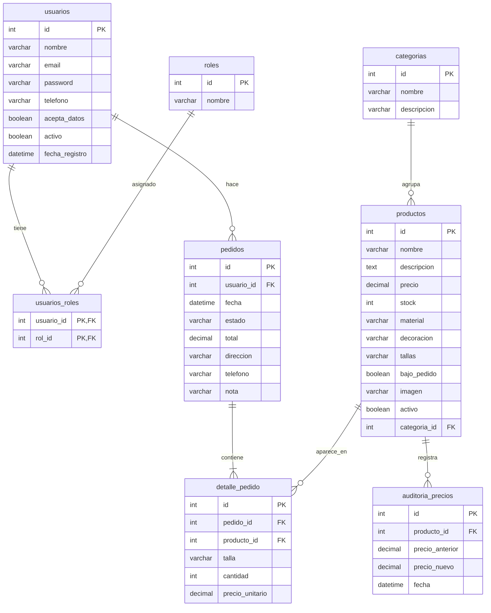

# Modelo de datos de KHAZA

Este documento tiene el **modelo entidad-relación (MER)** y el **diccionario de datos** que pide la
plantilla del documento final (sección 3.3.5). La base de datos es MySQL y se llama `khaza`.

## 1. Entidades y relaciones

| Entidad | Qué guarda |
|---|---|
| `roles` | Los perfiles del sistema: ADMIN y CLIENTE |
| `usuarios` | Las personas que se registran en la tienda |
| `usuarios_roles` | Qué rol tiene cada usuario (tabla intermedia, como en el ejercicio de clase) |
| `categorias` | Grupos de productos: Sombreros, Ropa |
| `productos` | Lo que se vende, con su precio y su stock |
| `pedidos` | Cada compra que hace un cliente |
| `detalle_pedido` | Los productos que van dentro de cada pedido |
| `auditoria_precios` | Historial de cambios de precio (lo llena un trigger) |

Relaciones:

- Un **usuario** puede tener varios **roles** y un rol lo tienen varios usuarios → muchos a muchos
  con la tabla `usuarios_roles`.
- Una **categoría** tiene muchos **productos**; cada producto pertenece a una categoría → uno a muchos.
- Un **usuario** hace muchos **pedidos**; cada pedido es de un usuario → uno a muchos.
- Un **pedido** tiene muchas líneas de **detalle_pedido**, y cada línea apunta a un **producto**.
  `detalle_pedido` resuelve la relación muchos a muchos entre pedidos y productos.
- Un **producto** tiene muchos registros en **auditoria_precios**.

## 2. Diagrama MER

> Para verlo como imagen: pegar este bloque en <https://mermaid.live> o abrir este archivo en VS Code
> con la extensión *Markdown Preview Mermaid Support*. Para el documento final se puede redibujar en
> draw.io, como dice el anteproyecto.

## 3. Diccionario de datos

### roles

| Campo | Tipo | Nulo | Clave | Descripción |
|---|---|---|---|---|
| id | INT | No | PK, autoincremento | Identificador del rol |
| nombre | VARCHAR(20) | No | Único | `ADMIN` o `CLIENTE` |

### usuarios

| Campo | Tipo | Nulo | Clave | Descripción |
|---|---|---|---|---|
| id | INT | No | PK, autoincremento | Identificador del usuario |
| nombre | VARCHAR(100) | No | | Nombre completo |
| email | VARCHAR(100) | No | Único | Correo con el que inicia sesión |
| password | VARCHAR(100) | Sí | | Contraseña cifrada con BCrypt. Queda vacía si entra con Google |
| telefono | VARCHAR(20) | Sí | | Celular de contacto |
| acepta_datos | BOOLEAN | No | | Autorizó el tratamiento de datos (Ley 1581 de 2012) |
| activo | BOOLEAN | No | | Si está en `false` no puede iniciar sesión |
| fecha_registro | DATETIME | No | | Cuándo se registró |

### usuarios_roles

| Campo | Tipo | Nulo | Clave | Descripción |
|---|---|---|---|---|
| usuario_id | INT | No | PK, FK → usuarios.id | Usuario |
| rol_id | INT | No | PK, FK → roles.id | Rol que tiene |

### categorias

| Campo | Tipo | Nulo | Clave | Descripción |
|---|---|---|---|---|
| id | INT | No | PK, autoincremento | Identificador de la categoría |
| nombre | VARCHAR(50) | No | Único | Nombre visible, por ejemplo "Sombreros" |
| descripcion | VARCHAR(255) | Sí | | Texto corto opcional |

### productos

| Campo | Tipo | Nulo | Clave | Descripción |
|---|---|---|---|---|
| id | INT | No | PK, autoincremento | Identificador del producto |
| nombre | VARCHAR(100) | No | | Nombre del producto |
| descripcion | TEXT | Sí | | Descripción larga |
| precio | DECIMAL(10,2) | No | | Precio en pesos colombianos (COP) |
| stock | INT | No | | Unidades disponibles. La descuenta un trigger |
| material | VARCHAR(50) | Sí | | Material base, por ejemplo "Palma de iraca" |
| decoracion | VARCHAR(100) | Sí | | Tipo de decoración, por ejemplo "Hilos y mostacilla" |
| tallas | VARCHAR(50) | No | | Tallas disponibles separadas por coma, por ejemplo `S,M,L` |
| bajo_pedido | BOOLEAN | No | | Si es `true` se puede pedir aunque no haya stock |
| imagen | VARCHAR(255) | Sí | | Ruta de la foto, por ejemplo `img/productos/sombrero-rosa.jpg` |
| activo | BOOLEAN | No | | Si está en `false` no aparece en el catálogo |
| categoria_id | INT | No | FK → categorias.id | Categoría a la que pertenece |

### pedidos

| Campo | Tipo | Nulo | Clave | Descripción |
|---|---|---|---|---|
| id | INT | No | PK, autoincremento | Número del pedido |
| usuario_id | INT | No | FK → usuarios.id | Cliente que hizo el pedido |
| fecha | DATETIME | No | | Fecha y hora del pedido |
| estado | VARCHAR(20) | No | | `PENDIENTE`, `ENVIADO` o `ENTREGADO` |
| total | DECIMAL(10,2) | No | | Suma de los productos del pedido |
| direccion | VARCHAR(200) | No | | Dirección de entrega |
| telefono | VARCHAR(20) | No | | Teléfono para coordinar el envío |
| nota | VARCHAR(500) | Sí | | Nota de personalización del cliente |

### detalle_pedido

| Campo | Tipo | Nulo | Clave | Descripción |
|---|---|---|---|---|
| id | INT | No | PK, autoincremento | Identificador de la línea |
| pedido_id | INT | No | FK → pedidos.id | Pedido al que pertenece |
| producto_id | INT | No | FK → productos.id | Producto comprado |
| talla | VARCHAR(10) | No | | Talla elegida |
| cantidad | INT | No | | Unidades |
| precio_unitario | DECIMAL(10,2) | No | | Precio al momento de la compra |

> `precio_unitario` se guarda aparte del precio del producto porque el precio puede cambiar después.
> Así el pedido sigue mostrando lo que el cliente pagó.

### auditoria_precios

| Campo | Tipo | Nulo | Clave | Descripción |
|---|---|---|---|---|
| id | INT | No | PK, autoincremento | Identificador del registro |
| producto_id | INT | No | FK → productos.id | Producto cuyo precio cambió |
| precio_anterior | DECIMAL(10,2) | No | | Precio antes del cambio |
| precio_nuevo | DECIMAL(10,2) | No | | Precio después del cambio |
| fecha | DATETIME | No | | Cuándo cambió |

## 4. Triggers (se implementan en la Fase 2)

| Trigger | Cuándo se ejecuta | Qué hace |
|---|---|---|
| `trg_descontar_stock` | `AFTER INSERT` en `detalle_pedido` | Resta la cantidad comprada del stock del producto, salvo que sea bajo pedido |
| `trg_auditar_precio` | `AFTER UPDATE` en `productos` | Si el precio cambió, guarda el precio anterior y el nuevo en `auditoria_precios` |

## 5. Normalización

- **1FN:** cada campo guarda un solo valor. Los productos de un pedido no van en una columna con una
  lista, sino en filas de `detalle_pedido`.
- **2FN:** en `usuarios_roles`, la única tabla con clave compuesta, no hay campos que dependan solo
  de una parte de la clave.
- **3FN:** el nombre de la categoría no se repite en cada producto; el producto solo guarda
  `categoria_id`.
- Excepción consciente: `tallas` guarda una lista corta separada por comas (`S,M,L`). Se dejó así
  porque solo se usa para mostrar las opciones al cliente y nunca se consulta por talla. La talla que
  el cliente elige sí queda en su propia columna en `detalle_pedido`.
